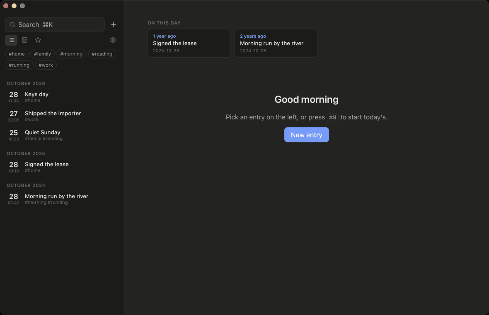

# Dayfile

Your day drafts itself from what you already left behind (commits, calendar,
photos), you add how it felt, and the journal becomes long-term memory your AI
agent can read. All of it is plain Markdown in a folder you own.



## Why

Journals die because writing every day is work. Agents forget you because
their memory lives in someone else's cloud, in a form you cannot read or fix.
Dayfile does both jobs with one folder.

- **A day that writes its first draft.** Point it at your code folders, a
  calendar feed and a photo folder. When you open the app (or at your
  reminder time) it drafts today: meetings, what you committed, where the
  photos were taken. You add a line about how it went and keep it, or discard
  it. Nothing runs in the background and nothing is read that you did not list.
- **Memory with a timeline.** Your agent pulls durable facts out of entries
  (where you live, who people are, what you are working on) into
  `memory/<topic>.md`. Facts are never overwritten. A new fact ends the old
  one, so "where did I live in 2023?" and "what did the journal believe last
  month?" both have answers, and every fact links to the entry it came from.
  You can open the file and correct it.
- **Plain files.** One `.md` per entry with YAML frontmatter, photos in a
  content-addressed folder, memory as readable YAML. Sync with iCloud Drive,
  Dropbox, Syncthing or git. The SQLite index is a cache rebuilt from the
  files. See [`docs/format.md`](docs/format.md).
- **A real journal app.** Timeline, calendar, On This Day, full-text search
  (works for Korean, Japanese, Chinese), tags, templates, a passcode lock, a
  reminder, a trash with Undo, and Day One import.

## Install

Desktop app: download the build for macOS, Windows or Linux from
[Releases](https://github.com/sjh9714/dayfile/releases). The macOS builds are
signed and notarized.

CLI (also the MCP server):

```sh
brew install --cask sjh9714/tap/dayfile   # macOS; or grab a binary from Releases
dayfile init                              # creates ~/Journal (or follows the app's folder)
```

## Draft your day

```sh
dayfile sources add git ~/code
dayfile sources author you@example.com      # only your commits
dayfile sources add calendar "https://calendar.google.com/calendar/ical/…/basic.ics"
dayfile sources add photos ~/Pictures/Phone
dayfile capture                             # today's draft
dayfile drafts                              # what waits for review
dayfile accept <id>                         # keep it (or `dayfile delete <id>`)
```

A draft looks like this, and stays out of the timeline, search and stats until
you keep it:

```markdown
Standup +1, 4 commits to shop-api, 3 photos

- 09:30–09:45 · Standup
- 10:12–16:40 · shop-api · 4 commits (Add order endpoint; Fix refund rounding; +2 more)
- 19:00–21:00 · Algorithms study
- 18:20–18:41 · 3 photos
```

Capturing the same day again only adds what is new. The app does the same from
Settings → Capture.

## Let your agent in

```sh
claude mcp add dayfile -- dayfile mcp serve
```

Claude Desktop: download the `.mcpb` file from Releases and open it.

The server has 19 tools and two prompts. Run the `review_day` prompt in the
evening: the agent captures the day, asks you a couple of questions, writes the
entry in your words, and records what it learned in memory. Then ask things
like "what did I work on last week?", "when did I move to Seoul?", or "summarise
my month". `--read-only` if you only want it to read. Details in
[`docs/mcp.md`](docs/mcp.md).

## Memory from the shell

```sh
dayfile remember Home "Lives in Seoul" --since 2024-03-01 --replaces f3a9c2e1
dayfile recall --topic home --as-of 2023-06-01      # Lives in Busan
dayfile history Home
dayfile topics
```

## Everyday journaling

```sh
dayfile add "First entry" -t life
dayfile add --template gratitude
dayfile search river
dayfile on-this-day
dayfile stats
dayfile delete <id>                # to the trash; `dayfile trash restore <id>` undoes it
```

## Import from Day One

Day One → Export → JSON. Then in the app: Settings → Import Day One export,
or:

```sh
dayfile import dayone ~/Downloads/Export.zip
```

Entries, photos, tags, location, weather and stars come across. Re-importing
never duplicates.

## On your phone

There is no mobile app yet. Because entries are plain Markdown files, keep
the journal folder in iCloud Drive (or Dropbox, Syncthing) and open it with
any Markdown editor on the phone. On iPhone, [Obsidian](https://obsidian.md)
(free) works well: create a vault, choose "Existing folder", pick the journal
folder in iCloud Drive, and new entries follow the format in
[`docs/format.md`](docs/format.md). The desktop app picks the edits up the
next time it is focused.

## Privacy

No account, no server, no telemetry. Capture reads only the folders and feeds
you list, only when you or your agent ask (or at app launch and the reminder).
Calendar and git sources stay in the app's config on this machine, not in the
synced folder. Optional location and weather for new entries use the OS
location service or a city-level guess from ipapi.co, then Open-Meteo; one
toggle turns that off.

## Build from source

```sh
(cd apps/desktop && npm install)
scripts/check.sh                       # tests, clippy, web build
cd apps/desktop && npm run tauri build
```

## Status

Desktop app (macOS, Windows, Linux), CLI, MCP, capture from git, calendars and
photos, bi-temporal memory, Day One import. Not yet: mobile, built-in sync,
encryption at rest, more capture sources (shell history, browser).

MIT. "Day One" is a trademark of Automattic; this project only reads its
export format.
